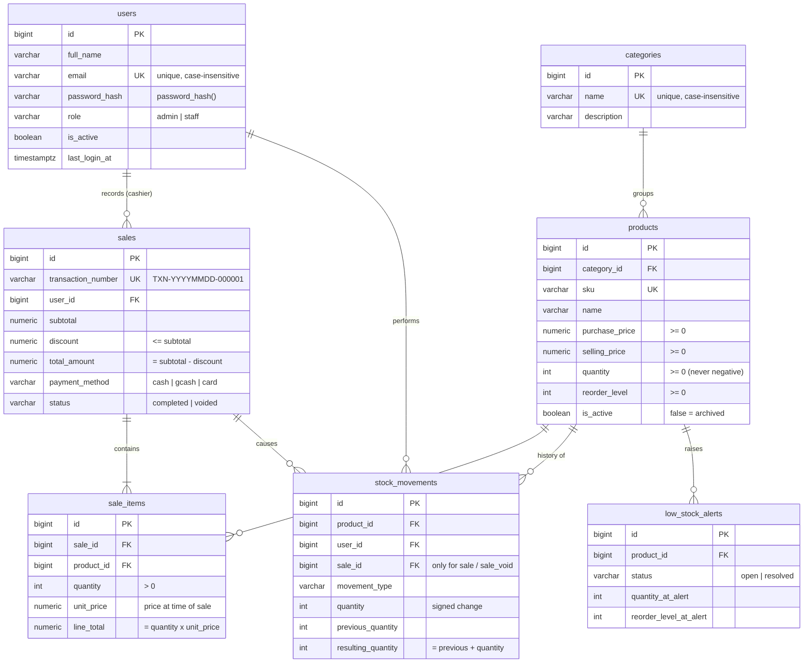

# Database design

PostgreSQL (Supabase). Source of truth: [`database/schema.sql`](../database/schema.sql).

## Entity-relationship diagram

## Tables

| Table | Purpose |
|---|---|
| `users` | Accounts that can log in. Passwords are stored only as bcrypt hashes. |
| `categories` | Product groups. Cannot be deleted while any product (even archived) uses it. |
| `products` | The catalog and the **current** stock quantity. |
| `sales` | One row per transaction (header: totals, payment, cashier, status). |
| `sale_items` | The lines of a sale. `unit_price` is copied at sale time so later price changes do not rewrite history. |
| `stock_movements` | **Audit trail**: every change to a product's quantity, who did it and why. |
| `low_stock_alerts` | Alert history. At most one *open* alert per product. |

## How data integrity is guaranteed

| Rule | How |
|---|---|
| No duplicate SKUs | `UNIQUE (sku)` + friendly check in PHP |
| No duplicate category names / emails (any letter case) | `UNIQUE (lower(name))`, `UNIQUE (lower(email))` |
| No negative stock or prices | `CHECK (quantity >= 0)`, `CHECK (price >= 0)` |
| Movement math always correct | `CHECK (resulting_quantity = previous_quantity + quantity)` |
| Stock-in is positive, stock-out/sale is negative | `CHECK` on `movement_type` vs. sign |
| Sale totals consistent | `CHECK (total_amount = subtotal - discount)`, `CHECK (line_total = quantity * unit_price)` |
| History cannot be orphaned | All foreign keys use `ON DELETE RESTRICT` |
| One open alert per product | Partial unique index `ON low_stock_alerts (product_id) WHERE status = 'open'` |
| Unique transaction numbers | Database sequence `sales_txn_seq` + `UNIQUE (transaction_number)` |
| No half-saved sales | Every sale/stock change runs in one transaction (`BEGIN … COMMIT`, `ROLLBACK` on any error) |
| Two cashiers cannot oversell | `SELECT … FOR UPDATE` locks the product rows until the transaction ends |

## Why products are archived instead of deleted

Deleting a product that was sold would break `sale_items` and `stock_movements` history (and the
foreign keys forbid it). Instead, `is_active = false` hides it from sales and lists, while every report
still shows its past sales. A product can only be truly deleted if it was never sold or moved
(e.g. it was created by mistake).

## Indexes

Unique indexes for SKU, email, category name and transaction number; foreign-key indexes; date indexes
on `sales.created_at` and `stock_movements.created_at` for reports; a partial index for low-stock
products. All are in `schema.sql`.
